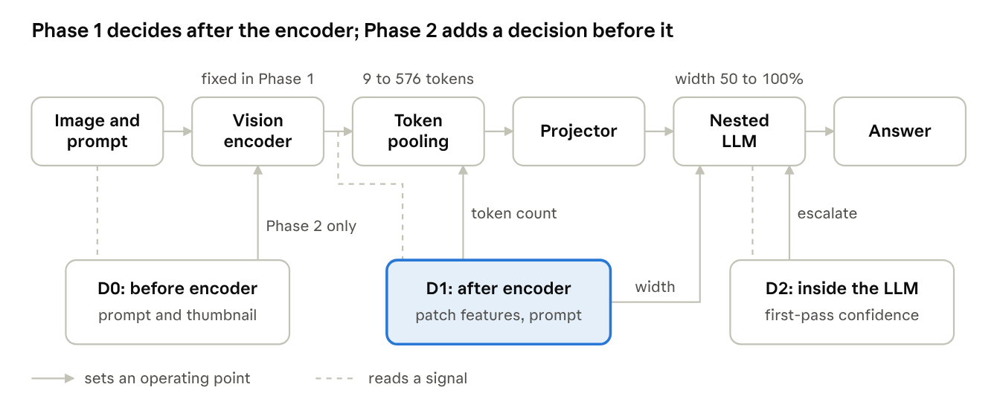

# Query-Aware Elastic VLM: Research and Implementation Plan

Nov 16, 2026 · @Sudaksh

## 1. Executive summary and research question

The project tests one claim: a cheap controller that sees the image and the prompt can choose a visual-token budget and a nested LLM width per query, and beat every fixed operating point at equal measured cost. Phase 1 controls those two axes with a fixed vision encoder. Phase 2 adds vision-side compute as a third axis.

**Working title.** Elastic by Query: Joint Visual-Token and LLM-Width Allocation in Nested Vision-Language Models.

**Problem.** A VLM spends the same compute on "what colour is the bus?" and on a dense chart question. Most per-query adaptation in the supplied papers changes how many reasoning tokens are generated. This project changes which subnetwork runs and how many visual tokens it reads.

**Central hypothesis.** The compute a query needs is partly predictable before LLM decoding from deployable image and prompt signals. If so, per-query selection over a grid of (visual tokens, LLM width) gives a better quality-compute frontier than the best fixed point on that grid.

**Intended contribution.** (1) A measured operating-point grid for one open VLM with trained nested width and nested visual tokens. (2) A controlled comparison of what signal predicts the needed budget. (3) A controller with a stated budget guarantee. Whether (3) is a method contribution depends on the size of the oracle gap measured in (1).

### Candidate research questions

1. **RQ1, headroom.** How far is the per-example oracle over the grid from the best fixed operating point, at matched average compute?
2. **RQ2, signal.** Which deployable signal closes most of that gap: prompt only, image only, joint, or early LLM confidence?
3. **RQ3, coupling.** Are the token axis and the width axis separable, or does the best token count depend on the width?
4. **RQ4, Phase 2.** Does vision-side elasticity add savings beyond token and width control once end-to-end latency is measured?

### What "query-aware" means

The controller may use only signals that exist at inference before the decision it makes. The table fixes the three decision points used in the rest of this plan.

| Decision point | Signals available | Cost to obtain | Can set |
| --- | --- | --- | --- |
| D0, before the vision encoder | Prompt text; prompt length and lexical features; image size and aspect ratio; cheap pixel statistics; a low-resolution thumbnail | CPU only, or one small text encoder pass | All axes, including vision compute in Phase 2 |
| D1, after the vision encoder, before the LLM | Everything in D0; encoder patch features and pooled feature; prompt-to-patch similarity | Free in Phase 1, since the encoder always runs | Retained tokens and LLM width |
| D2, inside the LLM | Everything in D1; hidden states or answer confidence from a first pass at the smallest operating point | A partial or full pass at the cheapest point, counted as overhead | Escalation to a larger point only |

**Disallowed.** Ground-truth answers. Benchmark names, task labels and question-type annotations taken from dataset metadata. Per-example correctness of any operating point on the evaluated example. Thresholds or budgets tuned on test data. Answer options are part of the prompt and are allowed.

### What "compute" means

Compute is reported as five separate quantities, never one blended score.

| Quantity | How measured | Why it is reported |
| --- | --- | --- |
| Theoretical cost (FLOPs or MACs) | Analytic count per stage from the active widths, depth and sequence length, cross-checked with a profiler | Hardware-independent, comparable across papers |
| Latency | Wall clock, end to end and per stage, batch size 1, warm GPU, median and p95 | What a user experiences |
| Peak GPU memory | `torch.cuda.max_memory_allocated` per request | Decides which GPU fits |
| Energy | GPU power sampling integrated over the request, only if the node allows it | Optional, marked as approximate |
| Visual tokens consumed by the LLM | Count at the LLM input | Explains the other four, but is not a cost |

**Why token count alone is not compute.** The vision encoder cost is fixed in Phase 1 whatever is retained afterwards. LLM prefill cost depends on width and on text tokens as well as visual tokens. Decode cost scales with answer length, which token pruning does not change. A method can therefore halve visual tokens and barely move latency.

## 2. Findings from the paper-summary file and related work

The supplied summary covers adaptive reasoning length, not nested subnetworks, so it motivates the controller but says nothing about how to build the elastic model. None of its 11 papers varies model width. The nested and elastic prior work in this section comes from independent web verification and is labelled as such.

### Materials inspected

- **Summary file used:** `papers_summary_and_comparison.md` in the root folder, read in full (507 lines). It is the only summary file.
- **Supporting files:** 11 PDFs, 7 in the root and 4 in `VLM/`. I read the first one or two pages of each to check titles, authors, venues and abstract-level claims. I did not re-read the full papers, so numbers that appear only in their body text remain as the summary states them.
- **Web access:** available and used. Sources I opened are linked. Items seen only in search results are marked "search result only".

### Evidence table A: what the supplied summary says

All 11 rows adapt compute per query. The "elastic dimension" in every row is generated tokens, rollouts or visual context, never a subnetwork.

| Work | Method and adapted dimension | Selection signal | Tasks and metrics | Limitation and relevance here |
| --- | --- | --- | --- | --- |
| [TALE](https://arxiv.org/abs/2412.18547) (Han et al., arXiv v6 2026) | Token budget in the prompt, or internalised by fine-tuning. Adapts reasoning length. | Zero-shot LLM estimate of the budget | GSM8K, MATH, SVAMP, ASDiv. Accuracy, output tokens. | Text only. Useful for its target definition: the minimal budget that still gives a correct answer. |
| [DAST](https://arxiv.org/abs/2503.04472) (Shen et al., arXiv v3 2026) | Preference fine-tuning (SimPO) against a token-length budget. Adapts reasoning length. | None at inference; learned into weights | MATH-500, AIME 2024, OlympiadBench. Accuracy, tokens. | Text only. Its budget formula blends pass rate with length, a usable soft label. |
| [SelfBudgeter](https://arxiv.org/abs/2505.11274) (Li et al., arXiv v6 2026) | Model emits a budget tag first, then answers within it. Trained with SFT then GRPO. | The model's own first tokens | GSM8K, MATH500, AIME2025. Accuracy, tokens. | Text only. Shows a user-set budget and a self-set budget can share one interface. |
| [Predictive Scheduling](https://arxiv.org/abs/2602.01237) (Brown et al., arXiv 2026) | Pre-run predictor plus greedy batch allocator. Adapts reasoning length under a fixed total. | MLP probe on mid-layer hidden states, or LoRA text classifier | GSM8K, MATH subsets. Accuracy at equal total tokens, share of oracle gap closed. | Text only. Direct template for the D2 probe and for reporting oracle-gap closure. |
| [Solve-then-Learn](https://arxiv.org/abs/2604.14853) (Zhai et al., arXiv 2026) | Lagrangian oracle labels, then a light classifier imitates them. Adapts number of rollouts. | Cheap input features, before generation | MATH, GSM8K. Accuracy at matched average budget, imitation accuracy. | Text only. The most reusable recipe: it turns budgeted control into supervised classification with a regret bound. |
| [Learning When to Think](https://arxiv.org/abs/2608.20256) (Kassenaar et al., arXiv v2 2026) | First output token picks one of three reasoning modes with hard caps. GRPO. | The model's own first token | MATH-500, GSM8K, AIME 2024. Accuracy, mean response length. | Text only, 1.5B model. Mode-collapse handling is relevant to a discrete controller. |
| [Reasoning on a Budget](https://arxiv.org/abs/2507.02076) (Alomrani et al., arXiv 2025) | Survey. Splits controllability (fixed budget) from adaptiveness (per input). | n/a | Proprietary reasoning models on AIME, MATH-500, GPQA and others | Gives the vocabulary: Section 5's two policies map to its L1 and L2. |
| [Ada-DeVL](https://aclanthology.org/2026.emnlp-main.417) (Fan et al., EMNLP 2026) | Four generation pathways on a 2x2 of visual analysis depth and logical depth. SFT then GRPO. | The model's own pathway tags | MMMU, MMMU-Pro, MathVista, ChartQA, DocVQA, HallusionBench. Accuracy, generated tokens. | Supports treating visual need and reasoning need as two axes. Adapts generated text, not input tokens or width. |
| Does Reasoning Improve Seeing? (Bi et al., ICML 2026, PMLR 306) | Linear probes for whether thinking helps and for needed length; head interventions. | Probe on final-layer last-token embedding | MathVista, MMMU, ChartQA, DocVQA and others (per summary) | Evidence that a VLM encodes its own need for compute linearly. Motivates the D2 probe. |
| [AVIS](https://arxiv.org/abs/2606.11576) (Jeddi et al., arXiv 2026) | Per-query policy over visual-token pruning and number of reasoning rollouts. | Learned difficulty predictor; training-free key-diversity pruning | Image and video reasoning benchmarks. Score against normalised FLOPs. | The closest work in the supplied set: two axes, one of them visual tokens. Second axis is rollouts, not width. |
| SPARC (Avogaro et al., ICML 2026, PMLR 306) | Two-stage prompting: find relevant crops, then reason on them. Scales the perception stage only. | The VLM's own crop proposals | V\* VQA, MMMU, RealWorldQA (per summary) | A coarse-then-fine vision pass. Precedent for the staged decision in Phase 2. |

### Evidence table B: nested and elastic work, verified independently

These works are not in the supplied summary. They define what "elastic" can mean in practice.

| Work | Elastic dimension | How a point is selected | Models and tasks | Limitation and relevance here |
| --- | --- | --- | --- | --- |
| [Matryoshka Multimodal Models (M3)](https://arxiv.org/abs/2405.17430), Cai et al., [ICLR 2025](https://matryoshka-mm.github.io/) | Visual tokens. Nested coarse-to-fine sets made by average pooling. | Set by the user per instance; no learned controller | LLaVA-1.5-7B and LLaVA-NeXT-7B. Code and checkpoints released for research use. | Reports a large gap between a per-sample oracle and fixed scales. That gap is this project's RQ1 on one axis. |
| [MatFormer](https://arxiv.org/abs/2310.07707), Devvrit et al., NeurIPS 2024 | FFN width, nested | Extracted per deployment | An 850M language model and a ViT encoder | Establishes that nested width must be trained in. FFN only. |
| [Flextron](https://arxiv.org/abs/2406.10260), Cai et al., ICML 2024 (venue from search result only) | Nested MLP and attention, in an LLM | Routers, described as input-adaptive, given a latency target | GPT-3 and Llama-2 families. Reports 7.63% of original pretraining tokens. | Closest text-only precedent for a per-input width router. No weight release confirmed. |
| [Gemma 3n](https://developers.googleblog.com/en/introducing-gemma-3n-developer-guide/), Google, 2025 | FFN width per layer (8192 to 16384) and layer skipping. E2B is trained inside E4B. | Per deployment via Mix-n-Match. Runtime switching was announced as not yet released. | Open-weight multimodal model, MobileNet-V5 vision encoder at 256, 512 and 768 px | The only openly released natively nested VLM I verified. Two trained points; in-between points are sliced, not trained. Licence not checked. |
| [HydraLLM](https://arxiv.org/abs/2610.23455), Kemme et al., EMNLP 2026 BabyLM workshop | Full width via active heads: embedding, attention, FFN, output head. Four points at 25/50/75/100%. | Per deployment; no per-input router | Gemma 3 270M decoder with a static SigLIP encoder. [Code linked](https://arxiv.org/html/2610.23455). | Shows a width-elastic VLM with a width-following projector is buildable. The paper reports near-random MMMU accuracy, so it is a recipe, not a baseline. |
| [AdaLLaVA](https://arxiv.org/abs/2503.10905), Xu et al., ICCV 2025 | LLM blocks (L variant) or heads and MLP groups (H variant), in the later half of the LLM | Learned scheduler conditioned on input and a budget token | LLaVA-1.5 with Vicuna-7B and 13B. VQAv2, ScienceQA, TextVQA, MME, MMBench, POPE. | The closest method overall. Tokens are reduced by fixed FastV or PruMerge+, not chosen per input. Budget is in FLOPs. Its own paper lists vision and token scheduling as future work. |
| [PARCEL](https://arxiv.org/abs/2605.30126), Kuzucu et al., arXiv 2026 | Visual tokens, one model at several budgets | Not described on the abstract page | 27 benchmarks reported | A stronger elastic-token connector than pooling. Candidate replacement for M3 later. |
| [OccamToken](https://arxiv.org/abs/2605.29657), Li et al., arXiv 2026 | Visual tokens, per image and per query | Training-free thresholds from attention | LLaVA-NeXT, LLaVA-1.5, Qwen3-VL | A query-adaptive token budget without a nested model. A baseline for the token axis. |
| [Visual Token Routing](https://arxiv.org/abs/2611.06854), Aggarwal and Welleck, arXiv Nov 2026 | Visual tokens, per region | Router trained jointly with the VLM | Computer-use benchmarks | Very recent. Shows the token axis alone is an active area. |
| [EA-ViT](https://arxiv.org/abs/2507.19360), Zhu et al., ICCV 2025 | ViT MLP ratio, heads, embedding dimension, depth | Router conditioned on budget and task | Adapts pretrained ViTs. [Code](https://github.com/zcxcf/EA-ViT). | A route to an elastic vision encoder for Phase 2 without training from scratch. |

Search results only, not opened: MQT-LLaVA ([arXiv 2405.19315](https://arxiv.org/pdf/2405.19315)), QTSplus ([arXiv 2511.11910](https://arxiv.org/pdf/2511.11910)), AsymVLM ([arXiv 2605.29535](https://arxiv.org/html/2605.29535v1)), and VL-RouterBench ([CVPR 2026](https://cvpr.thecvf.com/virtual/2026/poster/38113)), which routes between whole VLMs.

### Closest prior methods against this proposal

| Method | Visual tokens | LLM compute | Vision compute | Per-query policy | Training needed |
| --- | --- | --- | --- | --- | --- |
| M3 | Nested, trained | Fixed | Fixed | None (oracle analysis only) | Fine-tune LLaVA at several scales |
| AdaLLaVA | Fixed-ratio pruning add-on | Switched blocks or heads | Fixed | Learned, budget-conditioned | Joint fine-tune of LLM and scheduler |
| AVIS | Pruned per query | Rollout count | Fixed | Learned predictor | Predictor only |
| Flextron | n/a (text) | Nested width | n/a | Learned routers | Elastic continued pretraining |
| HydraLLM | Not varied | Nested width, 4 points | Fixed | None | Conversion with distillation |
| Gemma 3n | Fixed per resolution | Nested FFN width, layer skip | Three input resolutions | None | Already trained by Google |
| **This proposal, Phase 1** | Nested, chosen per query | Nested width, chosen per query | Fixed | Learned, with a budget constraint | Elastic fine-tune, then controller only |
| **This proposal, Phase 2** | As Phase 1 | As Phase 1 | Chosen per query | Staged | Adds elastic vision adaptation |

### The gap, with caveats

I found no verified work that chooses, per query, both a visual-token count and a trained nested LLM width. Each half exists separately: M3 and PARCEL for nested tokens, Flextron and HydraLLM for nested width, AdaLLaVA and AVIS for per-query policies on other axis pairs.

Three caveats limit that statement. The search was six queries, not a systematic review. AdaLLaVA names token and vision scheduling as its own future work, so a direct follow-up may exist. Combining two known axes is incremental unless the axes interact; Section 7 treats that interaction as the claim to test.

### Statements in the summary that need verification

1. **File naming.** `VLM/2505.11274v6.pdf` carries the SelfBudgeter arXiv number but contains the ICML 2026 paper "Does Reasoning Improve Seeing?". Its true identifier is unknown.
2. **AVIS models.** The summary lists Qwen2-VL-7B, InternVL-2.5-8B and LLaVA-OneVision-7B. The paper's introduction names Qwen2.5-VL as the primary backbone. The summary's description of the rollout policy as "early confidence agreement" plus "higher visual resolution" does not match the abstract, which describes a learned difficulty predictor and pruning before prefill.
3. **Ada-DeVL mechanism.** The summary says visual depth is modulated through "visual tokens and attention masks". The paper's figure shows pathways as output tag structures such as an image-analysis block before the answer. That is generated text, not input visual tokens.
4. **Solve-then-Learn.** The summary lists one author and a gradient-boosted model. The PDF lists five authors and the abstract says only "lightweight classifier".
5. **Does Reasoning Improve Seeing? models.** The abstract names InternVL and Qwen3-VL. The exact sizes in the summary are not confirmed at abstract level.
6. **Synthesis claims.** Section 5.4 of the summary states that larger models are more linearly separable and that small models gain most. Neither is tied to a specific result.
7. **Design advice that does not transfer.** The summary recommends first-token self-routing. A first token is produced after prefill, so it cannot choose the width or token count of that prefill. It can only trigger an escalation.

## 3. Proposed system and model choices

The recommended starter is a LLaVA-style model with a fixed CLIP encoder, M3 nested visual tokens, and a small open LLM that is fine-tuned to be width-elastic. No open checkpoint I verified is nested on both axes, so the width axis must be trained. Everything in this section is my proposal unless a source is linked.

### Assumptions used

- **Hardware.** One or two 48 GB GPUs for training (A40 or RTX 6000 Ada class) and 24 GB GPUs for evaluation. This is taken from your cluster notes, not from the summary.
- **Task.** Single-image question answering with short answers. The summary fixes no task.
- **Licensing.** Research use. Commercial constraints would change the encoder and data choices.
- **Latency target.** None given. The plan reports full frontiers, not one target.

### Component choices

| Component | Recommended starter | Alternative | Decision rule for switching |
| --- | --- | --- | --- |
| Vision encoder, Phase 1 | CLIP ViT-L/14 at 336 px, frozen, one forward pass per image. This is the encoder the released M3 checkpoints build on (unverified on the project page; confirm in the repo). | SigLIP 2 NaFlex, fixed at one sequence length. [Transformers docs](https://huggingface.co/docs/transformers/model_doc/siglip2) (search result only). | Use SigLIP 2 from the start if Phase 2 is certain, since it avoids swapping encoders between phases. |
| Vision encoder, Phase 2 | Elastic input sequence length on an encoder trained for it (NaFlex). | Nested depth and width adapted into the ViT, following [EA-ViT](https://arxiv.org/abs/2507.19360). | Move to the EA-ViT route only if profiling shows the encoder is above about 25% of end-to-end latency at the small LLM points. |
| Language model | Qwen2.5-1.5B-Instruct, made width-elastic by fine-tuning. Apache-2.0 per [its model repo](https://huggingface.co/Qwen/Qwen2.5-1.5B-Instruct/commits/main/LICENSE) (search result only). | (a) Vicuna-7B via the released LLaVA-1.5-7B-M3 checkpoint. (b) Gemma 3n E4B with its trained E2B sub-model. | Use 7B if four or more 48 GB GPUs are available for a week. Use Gemma 3n if elastic training fails Gate G2 in Section 8. |
| Connector | Two-layer MLP projector, as in LLaVA-1.5, trained with the LLM. Output width is fixed because the residual width is fixed. | An elastic resampler such as [PARCEL](https://arxiv.org/abs/2605.30126), if pooled tokens lose too much at 9 and 36. | Switch if the 36-token point trails the 576-token point by more than the Gate G1 tolerance on text-heavy benchmarks. |
| Token mechanism | M3 average pooling of the encoder's 24 x 24 grid into nested grids. Trained in, so every scale is a supported point. | Training-free query-aware pruning such as [OccamToken](https://arxiv.org/abs/2605.29657), used as a baseline. | Keep pooling as the primary. Pruning is compared, not adopted, unless it wins at matched measured latency. |

### How width elasticity is realised

**Definition.** Width here means the fraction of FFN hidden units and attention heads active in each LLM layer. The residual stream, embeddings and layer count stay full. This follows [MatFormer](https://arxiv.org/abs/2310.07707) for FFN and [Flextron](https://arxiv.org/abs/2406.10260) for attention.

**Why not slice a stock checkpoint.** A pretrained LLM is not trained so that its first k FFN units form a working model. Slicing Qwen or Vicuna directly gives an invalid subnet. The width points become valid only after elastic training.

**Training recipe (proposed).** Reorder FFN units and heads by importance, then fine-tune with the sandwich rule: each step runs the full width, the smallest width and one random width. The full-width model's logits are the distillation target for the smaller widths. [HydraLLM](https://arxiv.org/abs/2610.23455) reports a similar reorder-then-distil pipeline.

**Status of each LLM option.**

| Option | Nested status | What it costs |
| --- | --- | --- |
| Qwen2.5-1.5B, elastic fine-tune | Requires elastic training. Not native. | Full fine-tune fits on 48 GB. Multi-width steps cost roughly three forward passes each. |
| Vicuna-7B with per-width LoRA | An approximation. Each width gets an adapter on a sliced base. | Cheaper, but the widths share less and quality at small widths is at risk. |
| Gemma 3n E4B and E2B | Natively nested at two trained points. In-between points are sliced by Mix-n-Match, not trained. [Source](https://developers.googleblog.com/en/introducing-gemma-3n-developer-guide/). | No elastic training. Token nesting still needs fine-tuning. Runtime switching must be implemented. |

**What width is not.** Depth elasticity removes layers. Early exit stops at an intermediate layer per token. Quantisation changes numeric precision. Each is a separate axis and none is used in Phase 1. AdaLLaVA's block switching is depth-like and its head switching is width-like, but neither is a nested prefix structure.

### Visual-token interface and naming

Three counts differ and are reported separately.

| Name | Meaning | Starter value |
| --- | --- | --- |
| N\_enc | Tokens the encoder produces | 576 (24 x 24 patches) |
| N\_ret | Tokens retained after pooling or pruning | 9, 36, 144 or 576 |
| N\_llm | Visual tokens the LLM actually reads, including any separator tokens | Equals N\_ret in LLaVA-1.5; larger in multi-crop models |

The M3 scales 1, 9, 36, 144 and 576 are from my recollection of the paper; the project page confirms only 576, 9 and 1. Confirm in the repository before fixing the grid.

**Positional compatibility.** Pooled tokens stay on a regular grid in raster order, so the LLM sees the same ordering convention at every scale. The projector is applied after pooling in M3's design (confirm in code). For pruning baselines, retained tokens keep raster order.

### Operating points

| Stage | Phase 1 points | Phase 2 addition |
| --- | --- | --- |
| Vision encoder | One fixed point | Two or three sequence lengths, for example 256 and 576 patches |
| Visual tokens N\_ret | 9, 36, 144, 576 | Must not exceed the N\_enc of the chosen vision point |
| LLM width | 50%, 75%, 100% to start; add 25% only if it stays above the fixed-budget baseline | Unchanged |

Phase 1 has 12 grid points and all combinations are valid, because the residual width is fixed and the projector is shared. Phase 2 adds the constraint N\_ret <= N\_enc. Each point's cost is measured once on the target GPU and stored in a lookup table that the controller reads.

### How cost is computed per stage

For a request with N\_llm visual tokens, T text tokens, width w and n generated tokens, the analytic LLM cost is prefill over N\_llm + T positions at width w, plus n decode steps at width w with a cache. The encoder and projector costs are constants in Phase 1. Controller cost is added on every request.

### Minimal stack and reproducibility

- **Software.** PyTorch, Hugging Face Transformers, the LLaVA and M3 training code, and lmms-eval for benchmarks. Pin exact versions in a lockfile.
- **Measurement.** Analytic FLOP counter cross-checked with a profiler on three points. Wall clock with CUDA synchronisation, 20 warm-up requests, batch size 1, fp16. GPU model and driver recorded with every number.
- **Reproducibility.** Fixed seeds, greedy decoding, a fixed max of new tokens, config hashes stored with every result row, and one results table keyed by (example, operating point).

## 4. Implementation plan, split by phase

The plan has three phases and each ends in a gate: Phase 0 measures, Phase 1 builds the two-axis elastic model and its controller, Phase 2 adds vision compute. The backbone is always frozen while a controller is trained, so controller quality and subnet quality are never mixed.



Phase 1 uses D1, where encoder features are already paid for, to set the token count and the LLM width. D0 exists only to choose vision compute in Phase 2, and D2 is an optional escalation whose extra pass is charged to the request.

### Phase 0: fixed baseline and instrumentation

No training. Everything is frozen.

1. Run the released LLaVA-1.5-7B-M3 checkpoint through lmms-eval at full tokens. Reproduce its reported scores within about 1 point.
2. Build the profiler: per-stage wall clock for preprocessing, encoder, connector, LLM prefill and LLM decode; peak memory; analytic FLOPs.
3. Sweep the M3 token scales on the training split of each benchmark. Store correctness per (example, scale).
4. Compute the token-axis oracle gap and the share of examples solved at each smallest sufficient scale.
5. Write the evaluation protocol of Section 6 as a config file and freeze it.

**Deliverables.** A reproduced baseline table, a per-stage cost breakdown, a token-axis oracle curve, and the frozen protocol.

**Failure modes and diagnostics.** Scores off by more than 1 point usually mean a prompt-template or answer-normalisation mismatch. Latency variance above 5% between repeats means the timing harness is not synchronised.

**Ablations.** Batch size 1 against 8. fp16 against bf16. Answer length caps.

**Gate G0.** Proceed if the baseline is reproduced and the token-axis oracle beats the best fixed scale by at least 3 accuracy points at matched average tokens on two or more benchmarks. If the gap is smaller, the token axis alone has little headroom and the width axis must carry the project.

### Phase 1: token-budget and LLM-width controller

The vision encoder runs one fixed path. Tokens are reduced after the encoder by pooling. This phase is not end-to-end elastic vision compute.

**Stage 1a, build the elastic model (trained).**

1. Train a standard LLaVA-style model on the starter LLM with the LLaVA-1.5 data recipe. This is the non-elastic reference.
2. Add M3 token nesting. Check each scale against the reference.
3. Reorder FFN units and heads by importance. Fine-tune with the sandwich rule and distillation from full width, sampling a token scale and a width each step.
4. Evaluate all 12 grid points. Compare the full-width, full-token point against the reference from step 1.

- **Training data.** The LLaVA-1.5 pretraining and instruction-tuning mixes (sizes to confirm in the LLaVA repository).
- **Training type.** Supervised, with logit distillation for the smaller widths.
- **Trained.** Projector and LLM. **Frozen.** Vision encoder.

**Stage 1b, build the controller (backbone frozen).**

1. Sweep the 12 grid points over a controller-training split. Store correctness, cost and answer confidence per (example, point).
2. Derive targets. For the quality-aware policy, the target is the cheapest point that is correct. For the budget policy, targets come from the Lagrangian rule: pick the point that maximises expected correctness minus lambda times cost, following [Solve-then-Learn](https://arxiv.org/abs/2604.14853).
3. Train the estimators of Section 5 on those targets.
4. Calibrate on a held-out validation split. Choose lambda or the quality threshold there, never on test.

- **Training data.** Training splits of the evaluation benchmarks plus held-out portions of the instruction mix. Roughly 20k to 50k examples, each run at 12 points.
- **Training type.** Supervised from sweep labels, then calibration only. Policy-gradient training is a later option, not the default.
- **Trained.** Controller only. **Frozen.** Encoder, projector, LLM.

**Control interface.** `select(image, prompt, budget) -> (N_ret, w)`. The budget argument is either a quality threshold or an average-cost target. The controller returns one of the 12 valid points and a confidence.

**The two policies.**

| Policy | Objective | Knob | Guarantee reported |
| --- | --- | --- | --- |
| Quality-aware | Lowest cost such that predicted correctness is at least tau | tau | Realised accuracy drop against the full model |
| Budget-constrained | Highest expected correctness such that average cost is at most B | lambda, set by binary search on validation | Budget-violation rate on test |

**Fallback behaviour.** If controller confidence is below a calibrated threshold, use the largest point. If the controller is unavailable, use the best fixed point for the budget. A hard per-request cost cap overrides any choice.

**Keeping a weak controller apart from a weak subnet.** Every result reports three curves on the same subnets: the fixed-point frontier, the per-example oracle, and the controller. Subnet weakness shows as a low fixed frontier. Controller weakness shows as regret against the oracle. A random policy at matched budget is the floor.

**Failure modes and diagnostics.**

- Elastic training lowers full-width quality. Check: full point against the step 1 reference.
- Small widths collapse. Check: per-width loss curves; drop the point if it never beats a fixed baseline at equal cost.
- Controller collapses to one point. Check: the histogram of chosen points.
- Sweep labels are noisy because correctness is binary. Check: label stability under prompt paraphrase.
- Savings vanish in wall clock. Check: controller overhead and decode length per point.

**Ablations.** Token axis only, width axis only, both. Pooling against pruning. Sandwich training with and without distillation. Three widths against four.

**Gate G1 (model).** Proceed to the controller if the full point is within 1 accuracy point of the reference and the 75% width point is within 3 points at full tokens.

**Gate G2 (controller).** Proceed to Phase 2 if the best deployable controller closes at least 30% of the oracle gap at matched measured latency, with a budget-violation rate under 5%.

### Phase 2: end-to-end elasticity

This phase adds vision-side operating points and selects all three axes. Nothing here is claimed for Phase 1.

1. Replace or adapt the encoder so that it supports two or three trained sequence lengths. Re-align the projector at each.
2. Re-run elastic training so every valid (vision point, N\_ret, width) triple is supported.
3. Extend the sweep and the cost lookup table to the joint grid.
4. Train the staged controller described below.
5. Measure end to end, including routing cost and any re-encoding.

**Joint action space.** A triple (v, N\_ret, w) with N\_ret no larger than the tokens produced at v. With 2 vision points, 4 token scales and 3 widths, about 20 triples are valid.

**When the decision can be made.** The vision point must be chosen at D0, before encoder features exist. A single pre-inference decision for all three axes would discard the encoder features, which Section 5 expects to be the strongest image signal. The plan therefore uses a staged decision.

| Stage | Chooses | From | Cost if wrong |
| --- | --- | --- | --- |
| D0 | Vision point v | Prompt features and a thumbnail | Re-encode at a higher point |
| D1 | N\_ret and w | Encoder features and prompt | Re-run the LLM at a larger point |
| D2, optional | Escalate or stop | Confidence of the first answer | One extra LLM pass |

**Coupling to handle.** Pooled tokens at a coarse scale are not a prefix of a finer scale, so an escalation cannot reuse the LLM cache. Its full cost is charged to the request. A lower vision point caps the token budget, so D0 errors propagate.

- **Training data.** Same sources as Phase 1, re-swept on the joint grid.
- **Training type.** Supervised alignment for the encoder points; supervised controller with calibration.
- **Trained.** Encoder adaptation and projector first, then LLM elastic fine-tune, then controller alone.

**Failure modes.** The encoder is a small share of latency, so the new axis saves little. D0 picks low resolution for text-heavy images. Escalations erase the savings.

**Ablations.** Single-shot D0 decision against staged. With and without D2. Vision axis frozen at full against elastic.

**Gate G3.** Keep the vision axis if it lowers median end-to-end latency by at least 10% at matched accuracy against the Phase 1 controller. Otherwise report it as a negative result.

## 5. Input-estimation and controller strategies to compare

Ten strategy variants in six families are compared on one frozen elastic model before any is adopted. The study's output is a ranking by oracle-gap closure at matched measured cost, not by accuracy alone. All strategies choose from the same 12 Phase 1 operating points.

### How training targets are generated

1. Split data three ways: controller-train, controller-validation, test. Test examples are never swept for training.
2. Run every operating point on every controller-train example with greedy decoding. Record correctness, measured cost and answer log-probability.
3. Build two label sets from that table. The quality label is the cheapest correct point, or "none" if no point is correct. The budget label is the Lagrangian choice for each lambda on a grid.
4. Examples where no point is correct, or every point is correct, carry no routing signal. Report their share; it bounds what any controller can achieve.

Ground-truth answers are used only here, offline, to build labels. No estimator sees them at inference.

### The strategies

| # | Strategy | Inputs and when available | Added overhead | Training labels and objective | Calibration | Main failure risk |
| --- | --- | --- | --- | --- | --- | --- |
| 1a | Fixed, single point | None | None | None | None | Baseline. Wastes compute on easy inputs. |
| 1b | Fixed, best point per budget | None. The point is picked on validation for each budget. | None | Validation sweep | None | The bar every adaptive method must beat. |
| 2a | Prompt-only, hand features | Prompt length, question word, presence of options, digits, OCR-like cue words. D0. | CPU, well under 1 ms | Gradient-boosted classifier on budget labels | Temperature scaling on validation | Learns dataset style, not difficulty. Fails under paraphrase. |
| 2b | Prompt-only, small text encoder | Sentence embedding of the prompt. D0. | One small encoder pass | MLP on budget labels | Same | Same, plus added latency. |
| 3a | Image-only, cheap statistics | Resolution, aspect ratio, edge density, entropy, text-region estimate on a thumbnail. D0. | CPU, a few ms | Gradient-boosted classifier | Same | Weak signal; cannot know what is asked. |
| 3b | Image-only, encoder features | Pooled encoder feature and patch-feature diversity. D1. | Near zero in Phase 1 | MLP on budget labels | Same | Ignores the question, so over-spends on complex images with easy questions. |
| 4 | Joint image and prompt | Encoder patch features, prompt token embeddings, and their similarity map. D1. | A two-layer cross-attention head, measured | MLP or small transformer on budget labels; optional per-point correctness regression | Temperature scaling; reliability diagram per point | Overfits with few labels. Most parameters, most tuning. |
| 5 | Oracle | Per-example sweep with ground truth | Not deployable | None | None | Reference ceiling only. Optimistic, since it also profits from lucky errors. |
| 6a | Confidence cascade | Answer log-probability from a run at the cheapest point. D2. | One full cheap pass on every request, plus a second pass on escalation | Threshold only | Threshold set on validation | Confidence is miscalibrated at small widths. Costly when most inputs escalate. |
| 6b | Calibrated probe | Hidden state at a middle layer of the cheapest point. D2. | A partial pass | Linear probe predicting whether the cheap answer is correct | Platt scaling | Probe signal may not exist in small non-reasoning models. |

### Notes on specific strategies

**Prompt-only is a hypothesis, not an assumption.** The text-only papers in the summary predict reasoning length from the question. Whether a question predicts the visual tokens or width it needs is untested here. A null result for 2a and 2b is informative and should be reported.

**The oracle is reported two ways.** The plain oracle takes the cheapest correct point. A stricter "stable oracle" counts a point as sufficient only if all larger points are also correct. The gap between them shows how much apparent headroom is noise.

**Strategy 6b draws on the supplied papers.** [Predictive Scheduling](https://arxiv.org/abs/2602.01237) finds the strongest length signal in middle layers, and the ICML 2026 probing paper finds that thinking-mode VLMs encode this linearly. Both results are for reasoning length. Transfer to width and token choice is unverified.

### Controlled protocol

- Same frozen model, data splits, prompts, decoding settings and operating points for all strategies.
- Each strategy is evaluated at five average-cost budgets, set as fractions of the full point's measured latency.
- Overhead is included in each strategy's cost. A strategy that saves LLM compute but adds a text encoder is charged for it.
- Each learned strategy is trained with three seeds.
- Reported per strategy: accuracy at each budget, oracle-gap closure, regret, budget-violation rate, overhead in ms, and calibration error.

### What decides the controller

Pick the cheapest strategy whose gap closure is within 5 percentage points of the best. If strategy 3b matches strategy 4, the question text is not needed and the system should be described as image-aware, not query-aware.

## 6. Evaluation plan and metrics

Evaluation uses six image question-answering benchmarks chosen to spread visual-token need, and reports quality and measured cost together at five budgets. A result counts only if it holds at matched wall-clock latency with controller overhead included.

### Benchmarks

| Benchmark | Why it is included | Role | Metric |
| --- | --- | --- | --- |
| VQAv2 | General questions; M3 reports COCO-style data needs few tokens | Controller training and in-domain test | VQA accuracy with standard answer normalisation |
| GQA | Compositional questions on scenes | Controller training and in-domain test | Exact match |
| TextVQA | Reading text in images; expected to need many tokens | In-domain test | VQA accuracy |
| ChartQA | Dense charts; expected to need many tokens and more width | Held-out from model training | Relaxed accuracy |
| POPE | Object hallucination; checks that small points do not hallucinate more | Held-out | Accuracy and F1 |
| MMBench | Broad multiple-choice skills | Held-out, never used for controller training | Accuracy |

Five of these overlap with [AdaLLaVA's](https://arxiv.org/abs/2503.10905) evaluation set, which allows a like-for-like comparison. All are available in lmms-eval per its [task list](https://cdn.jsdelivr.net/gh/EvolvingLMMs-Lab/lmms-eval@main/docs/advanced/current_tasks.md) (search result only; TextVQA task name unconfirmed).

**Trade-off in this choice.** Short-answer benchmarks make correctness cheap to score and sweep. They under-represent long reasoning, where decode cost dominates. MMMU or MathVista can be added later, but a 1.5B model scores low on them, which leaves little signal.

### Data separation and leakage

- Three disjoint splits per benchmark: controller-train, controller-validation, test. Splits are by image, so one image never appears on both sides.
- The LLaVA instruction mix contains VQAv2 and GQA training data (confirm in the repository). Those benchmarks are in-domain for the model. ChartQA, POPE and MMBench test transfer.
- The controller is also evaluated leave-one-benchmark-out, to show whether it learned difficulty or dataset identity.
- Question-type metadata is used for slicing results only, never as a controller input.

### Robustness slices

Report every headline metric by question type, by image resolution tercile, by oracle difficulty tier (smallest sufficient point), and under three paraphrases of each prompt on a 1,000-example subset.

### Efficiency metrics

Median and p95 end-to-end latency at batch size 1; throughput at batch size 8; peak GPU memory; N\_llm; analytic FLOPs per stage. Energy is reported only if per-job GPU power sampling is available on the node, and is then marked approximate.

### Trade-off metrics

Let A(c) be accuracy when a policy runs at average cost c, with cost normalised so the full point is 1.

**Area under the quality-cost curve**, over the evaluated cost range, by the trapezoid rule on the five budgets:

```latex
\mathrm{AUQC} = \frac{1}{c_{\max}-c_{\min}} \int_{c_{\min}}^{c_{\max}} A(c)\,dc
```

**Oracle-gap closure** at budget B, the primary controller metric:

```latex
\mathrm{GC}(B) = \frac{A_{\mathrm{ctrl}}(B) - A_{\mathrm{fixed}}(B)}{A_{\mathrm{oracle}}(B) - A_{\mathrm{fixed}}(B)}
```

A\_fixed is the best single point at that budget, chosen on validation. GC of 0 means no gain over fixed; 1 means oracle.

Also reported: accuracy at each fixed budget; cost at matched accuracy (the average cost at which the policy reaches 99% and 97% of full-point accuracy); and the Pareto frontier plot.

### Controller metrics

| Metric | Definition |
| --- | --- |
| Overhead | Controller wall clock per request, and as a share of end-to-end latency |
| Accuracy regret | Share of examples where the oracle point is correct and the chosen point is not |
| Cost regret | Mean extra cost of the chosen point over the oracle point, on examples both get right |
| Budget-violation rate | Share of bootstrap resamples of the test set whose mean cost exceeds B by more than 2% |
| Calibration | Expected calibration error of predicted correctness, per operating point |
| Choice distribution | Histogram of selected points, to detect collapse |

### Statistical reliability

- Paired bootstrap over test examples, 10,000 resamples, 95% intervals on every accuracy difference and on GC.
- McNemar's test for paired accuracy comparisons between two policies.
- Three seeds for every learned controller; mean and range reported.
- Latency measured in five repeated runs; median of medians reported with the range.
- Elastic model training is run once by default because of cost. This is stated as a limitation.

### Baselines

Full model. Each fixed grid point. Best fixed point per budget. Random policy at matched budget. A training-free query-aware pruner ([OccamToken](https://arxiv.org/abs/2605.29657) or FastV) at full width. The released M3 model at fixed scales. AdaLLaVA numbers, if its code runs on the same hardware; otherwise cited, not compared.

### Ablations

| Ablation | Question it answers |
| --- | --- |
| Image-only, prompt-only, joint signals | Is the system query-aware or only image-aware? |
| Token policy: fixed, adaptive pooling, adaptive pruning | Does the token axis need a controller? |
| Width policy: fixed, adaptive | Does the width axis need a controller? |
| Joint against two independent controllers | Do the axes interact (RQ3)? |
| Vision elasticity on and off (Phase 2 only) | Does the third axis pay for itself? |
| Overhead charged against not charged | How much of the gain survives honest accounting? |
| Supervised labels against Lagrangian labels against policy gradient | Does the training method matter? |

### Plots and tables to produce

1. Accuracy against latency: fixed-point frontier, oracle and each controller, per benchmark.
2. Heat map of accuracy over the token-by-width grid.
3. Heat map of how often each point is the oracle choice, per benchmark.
4. Gap closure by strategy and budget, with intervals.
5. Per-stage latency breakdown at four representative points.
6. Reliability diagrams for the chosen controller.

## 7. Novelty and paper ideas

Five distinct papers could come from this project; the empirical study (Idea 1) is the safest and the coupled controller (Idea 2) is the one that could become a strong method paper. All novelty ratings are provisional until a systematic literature review is done. Venue notes describe fit, not acceptance chances, and current-cycle scopes and deadlines were not checked.

| Idea | Type | Provisional novelty | Depends on |
| --- | --- | --- | --- |
| 1. What predicts the compute a VLM query needs? | Empirical study | Moderate | Phase 0 and Stage 1b |
| 2. Coupled token-width allocation under a budget | Method | Moderate, potentially strong | Gate G2 and a positive RQ3 |
| 3. A doubly nested VLM and its training recipe | Model and artifact | Low to moderate | Gate G1 |
| 4. Staged end-to-end elastic inference | Systems | Moderate | Phase 2 |
| 5. Does a narrow subnet know it is too narrow? | Analysis | Moderate | Stage 1b sweep data |

### Idea 1. What predicts the compute a VLM query needs?

- **Core claim and question.** On a fixed nested VLM, which deployable signal predicts the smallest sufficient operating point, and how much of the oracle gap is real?
- **Closest prior work.** M3's per-sample oracle analysis on the token axis. Predictive Scheduling and Solve-then-Learn for text reasoning length. VL-RouterBench for routing across whole models.
- **Differentiator.** A controlled comparison of prompt, image, joint and confidence signals inside one model, on two axes, with overhead charged and a noise-corrected oracle.
- **Evidence for novelty.** No existing study compares these signal families on nested operating points. A literature review must confirm that.
- **What would weaken it.** All signals perform alike, or the stable oracle shows most headroom is label noise. Both are still reportable but make a thinner paper.
- **Minimum experiments.** The Section 5 study on six benchmarks, leave-one-benchmark-out transfer, paraphrase robustness.
- **Venues by fit.** TMLR and the Findings tracks of ACL or EMNLP suit a careful empirical study. A NeurIPS evaluation-focused track is possible if the sweep table is released as a resource. An efficiency workshop at a vision or ML conference is the fallback.

### Idea 2. Coupled token-width allocation under a budget

- **Core claim and question.** The best token count depends on the LLM width. A joint controller with a stated budget guarantee beats two independent controllers and the best fixed point.
- **Closest prior work.** AdaLLaVA (per-input LLM subnetwork, tokens fixed), AVIS (tokens and rollouts), Flextron (width routing, text only).
- **Differentiator.** Per-query choice on two nested axes at once, trained by the Lagrangian label recipe, with measured-latency budgets.
- **Evidence for novelty.** A significant interaction term in the grid, and joint control beating independent control at matched latency with intervals that exclude zero.
- **What would falsify it.** The axes are separable, so independent controllers match the joint one. Or AdaLLaVA with an adaptive pruner reaches the same frontier.
- **Minimum experiments.** Idea 1's infrastructure, the joint-against-independent ablation, and a head-to-head with AdaLLaVA on shared benchmarks.
- **Venues by fit.** CVPR, ICCV or ECCV for the vision-efficiency audience; ICLR or NeurIPS if the budget-guarantee analysis is a main result. Full-conference potential only if the interaction is clear. Otherwise it is an incremental combination and fits a workshop.

### Idea 3. A doubly nested VLM and its training recipe

- **Core claim and question.** One set of weights can serve every (token scale, width) pair with small loss against separately trained models. What training schedule makes that hold?
- **Closest prior work.** M3 (tokens), MatFormer and Gemma 3n (FFN width), HydraLLM (width in a VLM, with weak multimodal quality by its own report).
- **Differentiator.** Both axes trained jointly at a usable model size, with released checkpoints.
- **Evidence for novelty.** Each grid point within a small margin of an individually trained model of equal cost.
- **What would weaken it.** Joint training costs more than it saves, or a later Gemma-family release ships the same thing.
- **Minimum experiments.** Grid quality against three or four individually trained points; ablations on sandwich rule, distillation and reordering.
- **Venues by fit.** A workshop or a short paper on its own. It is better as the model section of Idea 2 than as a standalone full paper.

### Idea 4. Staged end-to-end elastic inference

- **Core claim and question.** When do FLOP savings become latency savings in an elastic VLM, and does a staged decision beat a single pre-inference decision?
- **Closest prior work.** AdaLLaVA states that the FLOPs-to-latency relation varies by device and leaves system work to the future. SPARC uses a coarse-then-fine vision pass.
- **Differentiator.** Decision timing, escalation cost and cache reuse treated as first-class design variables, measured on real hardware across GPU classes.
- **Evidence for novelty.** Cases where the FLOP-optimal policy is not the latency-optimal policy, and a staged controller that wins in wall clock.
- **What would weaken it.** The encoder is too small a share of latency for the vision axis to matter (Gate G3 fails).
- **Minimum experiments.** Phase 2 on two GPU classes, with batch size 1 and batched serving.
- **Venues by fit.** MLSys, or a systems-for-ML workshop. A vision venue only if combined with Idea 2.

### Idea 5. Does a narrow subnet know it is too narrow?

- **Core claim and question.** In a nested model, the hidden states of the narrowest subnet linearly encode whether a wider subnet would change the answer.
- **Closest prior work.** The ICML 2026 probing paper in the supplied set, for thinking against direct answering. Predictive Scheduling, for reasoning length.
- **Differentiator.** Self-knowledge across nested widths and token scales, a setting those papers do not cover.
- **Evidence for novelty.** Probe accuracy well above confidence baselines, stable across benchmarks.
- **What would falsify it.** Probes do no better than answer log-probability.
- **Minimum experiments.** Layer-wise probes on the Stage 1b sweep; a cascade built from the best probe.
- **Venues by fit.** ICLR or ICML if the finding is clean; an interpretability or efficiency workshop otherwise.

### Reading the ratings

Combining token control and width control is not novel on its own count of axes. The claim that could carry a full paper is the interaction between them, or a finding about what signal predicts need. If neither appears, Idea 1 as an honest empirical study is the realistic outcome.

## 8. Recommended research sequence and decision gates

Twelve weeks cover Phase 0, all of Phase 1 and a Phase 2 pilot; a full Phase 2 needs a further six to eight weeks. The week 2 token sweep is the first deciding experiment, because it costs no training and shows whether per-query headroom exists at all.

### Week-by-week plan

| Weeks | Work | Concrete output | Gate |
| --- | --- | --- | --- |
| 1 | Reproduce LLaVA-1.5-7B-M3 in lmms-eval. Build the per-stage profiler. | Baseline table; latency breakdown |  |
| 2 | Sweep M3 token scales on training splits. Freeze the evaluation protocol. | Token-axis oracle curve; protocol config | G0 |
| 3 | Train the non-elastic reference model on the starter LLM. | Reference checkpoint and scores |  |
| 4 | Add M3 token nesting to the reference. | Scores at four token scales |  |
| 5 to 6 | Elastic width training. Evaluate the 12-point grid. | Elastic checkpoint; grid heat map; cost lookup table | G1 |
| 7 | Sweep the grid on controller-train. Build labels. Measure plain and stable oracle and the axis interaction. | Sweep table; oracle curves; interaction estimate |  |
| 8 | Train the estimators of Section 5. | Trained controllers, three seeds each |  |
| 9 | Run the controlled comparison. Pick the controller. | Gap-closure table with intervals | G2 |
| 10 | Robustness: leave-one-benchmark-out, paraphrases, AdaLLaVA comparison. | Robustness tables |  |
| 11 | Phase 2 pilot: encoder share of latency; test whether D0 signals predict the needed token scale. | Go or no-go memo for the vision axis | G3 pilot |
| 12 | Draft the Idea 1 paper. Decide on Idea 2 and full Phase 2. | Draft; decision record |  |

### Which experiment decides what

| Decision | Deciding experiment | When |
| --- | --- | --- |
| Token-selection mechanism | Token sweep on M3, plus pooling against a pruning baseline at matched latency | Weeks 2 and 6 |
| Language model | Whether the starter LLM passes G1 after elastic training | Week 6 |
| Controller features | The Section 5 comparison | Week 9 |
| Vision model for Phase 2 | Encoder latency share and D0 predictability | Week 11 |

### Gates, as tunable proposals

These thresholds are starting values. Adjust them after seeing the variance in weeks 1 and 2.

| Gate | Criterion | If it fails |
| --- | --- | --- |
| G0 | Baseline reproduced within 1 point. Token oracle beats best fixed scale by 3 points or more at matched tokens on two benchmarks. | Rely on the width axis, or add harder benchmarks where token need varies more. |
| G1 | Full point within 1 point of reference. 75% width within 3 points at full tokens. | Extend training, drop the smallest width, or switch to Gemma 3n's two trained points. |
| G2 | Best deployable controller closes 30% or more of the oracle gap at matched latency. Budget violations under 5%. | Publish Idea 1 as a study of why prediction is hard. Do not start Phase 2. |
| G3 | Vision axis lowers median latency by 10% or more at matched accuracy. | Report as a negative result. Keep Phase 1 as the system. |

### First two weeks

- [ ] Confirm GPU allocation and the shared results location on the cluster.
- [ ] Clone the M3 and lmms-eval repositories; pin versions; record commit hashes.
- [ ] Confirm the trained M3 token scales and where pooling sits relative to the projector.
- [ ] Reproduce full-token scores on VQAv2, GQA, TextVQA, POPE and MMBench.
- [ ] Implement and validate the timing harness on three operating points.
- [ ] Implement the analytic FLOP counter and cross-check it with a profiler.
- [ ] Define the three-way splits by image and store them as files.
- [ ] Run the token-scale sweep and compute the plain and stable oracle.
- [ ] Check licences for CLIP, Vicuna, Qwen2.5 and each dataset.
- [ ] Write the G0 result in one page and decide whether to proceed.

## 9. Risks, open questions, and final recommendation

The largest risk is that per-query headroom is small or unpredictable once label noise and controller overhead are counted, which is why the plan measures it before training anything. The recommended path is a small LLaVA-style model with M3 tokens and trained width elasticity, controlled at decision point D1.

### Ranked risks

| Rank | Risk | Why it matters | Mitigation |
| --- | --- | --- | --- |
| 1 | Oracle gap is mostly noise, or not predictable from deployable signals | Removes the reason for a controller | Stable oracle in week 2; Gate G2; Idea 1 survives as a study |
| 2 | Quality loss from width reduction | Small widths become useless, shrinking the grid to one axis | Sandwich training with distillation; Gate G1; Gemma 3n fallback |
| 3 | No open checkpoint is nested on both axes | Forces elastic training, the costliest step | Small starter LLM; reuse M3 for the token axis in Phase 0 |
| 4 | Fair compute measurement | FLOP savings may not appear in latency; token counts mislead | Per-stage wall clock on named hardware; overhead always charged |
| 5 | Controller overhead | A joint controller or a cascade can cost more than it saves at small points | D1 features are free in Phase 1; overhead reported as a share of latency |
| 6 | Image-prompt interaction is weak | The system would be image-aware only, weakening the framing | The 3b against 4 ablation decides the framing honestly |
| 7 | Training cost | Each elastic run is several GPU-days; few repeats are possible | One elastic model, many controllers; seeds on controllers only |
| 8 | Benchmark overlap with model training data | In-domain results overstate transfer | Held-out benchmarks and leave-one-out controller tests |
| 9 | Concurrent work | The area moves monthly; two relevant preprints appeared in October and November 2026 | Re-run the literature search before each write-up |

### Decisions to resolve before implementation

1. **Task scope.** Short-answer image QA only, or also long-form reasoning? The plan assumes short answers.
2. **Hardware and budget.** How many 48 GB GPU-days are available per week? This decides the 1.5B against 7B choice.
3. **Target of the claim.** Measured latency on a server GPU, or an edge device? The plan assumes a server GPU.
4. **Licensing.** Research only, or must weights be releasable commercially?
5. **Phase 2 commitment.** If it is certain, start with a variable-resolution encoder in Phase 1 to avoid a swap.

### Information still missing

Latency or quality targets; an energy-measurement setup; the true identifier of the misnamed PDF; confirmation of M3 token scales, LLaVA data-mix sizes and model licences from their repositories.

### Final recommendation

Start with the released M3 checkpoint and spend two weeks measuring per-query headroom on the token axis. If it exists, train one small LLaVA-style model that is nested in both visual tokens and LLM width, freeze it, and run the controlled comparison of estimators at decision point D1. Commit to a method paper only if the two axes interact and a deployable controller closes a meaningful share of the oracle gap at matched wall-clock latency. Treat vision-side elasticity as a later phase with its own gate. This path uses one training-heavy step, keeps every controller comparison on identical subnets, and yields a publishable empirical study even if the method claim fails.

| Item | Recommended initial configuration |
| --- | --- |
| Vision encoder | CLIP ViT-L/14 at 336 px, frozen, fixed compute (Phase 1) |
| Visual tokens | M3 nested pooling; N\_ret of 9, 36, 144 or 576 |
| Language model | Qwen2.5-1.5B-Instruct with trained nested width (FFN units and heads) at 50%, 75%, 100% |
| Connector | Two-layer MLP projector, shared across all points |
| Controller inputs | Encoder patch features and prompt embeddings at D1; prompt-only and image-only variants as ablations |
| Operating points | 12 valid (token, width) pairs in Phase 1; about 20 triples in Phase 2 |
| Training approach | Sandwich-rule elastic fine-tune with distillation; then supervised controller on sweep labels with Lagrangian budget targets and validation calibration |
| Benchmarks | VQAv2, GQA, TextVQA, ChartQA, POPE, MMBench |
| Primary metrics | Accuracy at fixed measured-latency budgets; oracle-gap closure; AUQC; p95 latency; budget-violation rate |

## 10. References

Sources are grouped by how they were checked. Details that appear only in the supplied summary, and not on a page I opened, are flagged in Section 2.

### Supplied papers (PDF first pages read locally)

1. Han, Wang, Fang, Zhao, Ma, Chen. Token-Budget-Aware LLM Reasoning. [arXiv:2412.18547](https://arxiv.org/abs/2412.18547), v6 2026.
2. Shen et al. DAST: Difficulty-Adaptive Slow Thinking for Large Reasoning Models. [arXiv:2503.04472](https://arxiv.org/abs/2503.04472), v3 2026.
3. Li, Dong, Ma, Zhang, Jia, Sui. SelfBudgeter: Adaptive Token Allocation for Efficient LLM Reasoning. [arXiv:2505.11274](https://arxiv.org/abs/2505.11274), v6 2026.
4. Alomrani, Zhang, et al. Reasoning on a Budget: A Survey of Adaptive and Controllable Test-Time Compute in LLMs. [arXiv:2507.02076](https://arxiv.org/abs/2507.02076), 2025.
5. Brown, Muppidi, Shahout. Predictive Scheduling for Efficient Inference-Time Reasoning in Large Language Models. [arXiv:2602.01237](https://arxiv.org/abs/2602.01237), 2026.
6. Zhai, Li, Xiao, Li, Wang. Adaptive Test-Time Compute Allocation for Reasoning LLMs via Constrained Policy Optimization. [arXiv:2604.14853](https://arxiv.org/abs/2604.14853), 2026. Preprint.
7. Kassenaar, Yang, François-Lavet. Learning When to Think: Adaptive Reasoning for Test-Time Compute Allocation. [arXiv:2608.20256](https://arxiv.org/abs/2608.20256), v2 2026.
8. Fan, Zhao, Shi, Zhou, Li. Ada-DeVL: Adaptive Decoupling of Visual and Logical Reasoning Pathways for Efficient MLLMs. EMNLP 2026, pages 9540 to 9562. [ACL Anthology 2026.emnlp-main.417](https://aclanthology.org/2026.emnlp-main.417) (link inferred from the file name).
9. Bi, Song, Zhang, Liu, Sun, Wen, Cai, Chen, Xu. Does Reasoning Improve Seeing? Understanding When Vision-Language Models Benefit from Thinking. ICML 2026, PMLR 306. Local file `VLM/2505.11274v6.pdf`; no verified link.
10. Jeddi et al. AVIS: Adaptive Test-Time Scaling for Vision-Language Models. [arXiv:2606.11576](https://arxiv.org/abs/2606.11576), 2026. Preprint. [Project page](https://avis-vlm.github.io/).
11. Avogaro, Debnath, Mi, Frick, Wang, He, Hua, Schindler, Rigotti. SPARC: Separating Perception And Reasoning Circuits for Test-time Scaling of VLMs. ICML 2026, PMLR 306. Local file `VLM/avogaro26a.pdf`; no verified link.

### Opened and read online

12. Cai, Yang, Gao, Lee. Matryoshka Multimodal Models. ICLR 2025. [arXiv:2405.17430](https://arxiv.org/abs/2405.17430); [project page](https://matryoshka-mm.github.io/).
13. Devvrit, Kudugunta, Kusupati, et al. MatFormer: Nested Transformer for Elastic Inference. NeurIPS 2024. [arXiv:2310.07707](https://arxiv.org/abs/2310.07707).
14. Cai, Muralidharan, Heinrich, Yin, Wang, Kautz, Molchanov. Flextron: Many-in-One Flexible Large Language Model. [arXiv:2406.10260](https://arxiv.org/abs/2406.10260), 2024. ICML 2024 per a search result of the [proceedings page](https://proceedings.mlr.press/v235/cai24e.html), not opened.
15. Xu, Nguyen, Mukherjee, Bagchi, Chaterji, Liang, Li. Learning to Inference Adaptively for Multimodal Large Language Models (AdaLLaVA). ICCV 2025. [arXiv:2503.10905](https://arxiv.org/abs/2503.10905).
16. Kemme, Haberer, Hojjat, Landsiedel. HydraLLM: Adaptive Width Slicing for Elastic Text and Vision-Language Models. BabyLM Workshop at EMNLP 2026. [arXiv:2610.23455](https://arxiv.org/abs/2610.23455).
17. Kuzucu, Tonioni, Lup, Schiele, Tombari, Naeem. PARCEL: Pool-Anchored Resampling with Conditioned Elastic Queries for Efficient Vision-Language Understanding. [arXiv:2605.30126](https://arxiv.org/abs/2605.30126), 2026. Preprint.
18. Li et al. OccamToken: Efficient VLM Inference with Training-Free and Budget-Adaptive Token Pruning. [arXiv:2605.29657](https://arxiv.org/abs/2605.29657), 2026. Preprint.
19. Aggarwal, Welleck. Visual Token Routing: Learning to keep tokens that matter. [arXiv:2611.06854](https://arxiv.org/abs/2611.06854), November 2026. Preprint.
20. Zhu et al. EA-ViT: Efficient Adaptation for Elastic Vision Transformer. ICCV 2025. [arXiv:2507.19360](https://arxiv.org/abs/2507.19360).
21. Google. Introducing Gemma 3n: The developer guide. [Google Developers Blog](https://developers.googleblog.com/en/introducing-gemma-3n-developer-guide/), 2025.

### Seen in search results only, not opened

22. Matryoshka Query Transformer for Large Vision-Language Models. [arXiv:2405.19315](https://arxiv.org/pdf/2405.19315).
23. Seeing the Forest and the Trees: Query-Aware Tokenizer for Long-Video (QTSplus). [arXiv:2511.11910](https://arxiv.org/pdf/2511.11910).
24. AsymVLM: Asymmetric Token Pruning for Efficient Vision-Language Model Inference. [arXiv:2605.29535](https://arxiv.org/html/2605.29535v1).
25. VL-RouterBench: A Benchmark for Vision-Language Model Routing. [CVPR 2026](https://cvpr.thecvf.com/virtual/2026/poster/38113).
26. SigLIP 2. [arXiv:2502.14786](https://arxiv.org/abs/2502.14786v1); [Transformers documentation](https://huggingface.co/docs/transformers/model_doc/siglip2).
27. lmms-eval [current task list](https://cdn.jsdelivr.net/gh/EvolvingLMMs-Lab/lmms-eval@main/docs/advanced/current_tasks.md).
28. Qwen2.5-1.5B-Instruct [licence file history](https://huggingface.co/Qwen/Qwen2.5-1.5B-Instruct/commits/main/LICENSE).

Not looked up and stated from memory, so treat as unverified: the LLaVA-1.5 data recipe and its inclusion of VQAv2 and GQA, CLIP ViT-L/14-336 as the M3 encoder, the full list of M3 token scales, and FastV.
