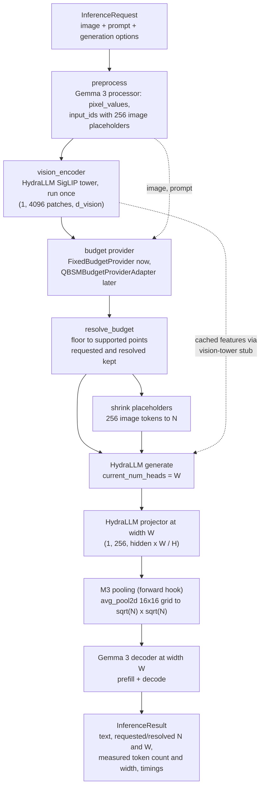

# hydram3-vlm

One inference path that combines **M3** visual-token budgets with **HydraLLM** LLM-width budgets, plus a
stable extension point for the **Query Budget Selection Module (QBSM)** that will choose the pair
`(N, W)` per request.

> **Status: integration layer, not a trained system.** The plumbing is tested. No checkpoint exists yet
> that was trained for *both* nested visual tokens and nested width, so quality at reduced budgets is
> unmeasured. The QBSM is a placeholder seam: the only provider implemented is a fixed budget.

## 1. Purpose and scope

| Component | Responsibility |
|---|---|
| **M3** ([`../matryoshka-mm`](../matryoshka-mm)) | The token mechanism: nested 2D average pooling of the projected visual-token grid (`matryoshka_vis_token_process`). |
| **HydraLLM** ([`../hydrallm`](../hydrallm)) | The model: multimodal HydraGemma 3 (SigLIP encoder, width-following projector, width-elastic Gemma 3 decoder) and its `generate`. |
| **This repo** | Orchestration, budget validation/resolution, adapters that apply `N` and `W` to HydraLLM without editing it, measured metadata, tests. |
| **QBSM (future, student)** | A predictor that maps the request (image, prompt, encoder features) to `(N, W)`. Plugs into `QBSMBudgetProviderAdapter`. |

**What it does now.** Takes one image and one prompt, gets `(N, W)` from a budget provider, runs HydraLLM's
SigLIP encoder once, pools HydraLLM's visual tokens to `N` with M3's operation, generates with HydraLLM at
`W` active heads, and returns the text with what was actually executed.

**What it does not do yet.**
- Learned or query-aware budget selection (only `FixedBudgetProvider` exists).
- Use M3's released checkpoints. Those are LLaVA-1.5/NeXT on **Vicuna-7B** (4096-d), whose visual
  tokens cannot be fed to a Gemma 3 decoder. What is reused from M3 is its pooling operation, applied to
  HydraLLM's own visual tokens.
- Guarantee quality below 256 visual tokens. M3 works because the LLM is *trained* on pooled tokens;
  HydraLLM's multimodal checkpoints are not. Producing a checkpoint trained on both axes is the Phase-1
  elastic fine-tune in the research plan ([`../docs`](../docs)).
- Batching (one request at a time), multiple images per prompt, pan-and-scan crops, Phase 2 (elastic vision
  encoder), MatFormer FFN-only width.

## 2. Architecture and data flow

The upstream code forces a staged flow:

- HydraLLM's projector output width depends on `W` (it follows the head count), and M3 pools *after* the
  projector, so `W` must be known before the projector and `N` before pooling.
- The SigLIP encoder depends on neither, so it runs first, and its features are available to the budget
  provider at no extra cost (decision point D1 in the research plan). The provider cannot influence the
  encoder, so there is no circular dependency.



How the values reach each upstream component, without modifying either repository:

- **`W` to HydraLLM:** passed as `current_num_heads=W` to HydraLLM's own `generate`. HydraLLM derives the
  embedding, FFN and projector output widths as `int(full_dim * W / num_attention_heads)`.
- **`N` to M3 pooling:** the processor emits `mm_tokens_per_image` (256) placeholder tokens per image. The
  adapter shortens that run to `N` (`shrink_image_token_runs`) and registers a forward hook on HydraLLM's
  `multi_modal_projector` that applies `matryoshka_pool(features, N)`. HydraLLM's own placeholder check then
  scatters exactly `N` features. The hook is removed in a `finally` block.
- **No second encoder pass:** during `generate`, `model.model.vision_tower` is temporarily replaced by a stub
  that returns the features computed in the `vision_encoder` stage, then restored.

## 3. Repository layout

```text
hydram3-vlm/
  README.md                     this file
  NOTICE                        upstream attribution
  pyproject.toml                package metadata, extras: hydra (real inference), dev (tests)
  configs/
    hydra_gemma3_270m_mm.yaml   example config with the operating points found in the upstream code
  src/hydram3/
    types.py                    request, budget, operating-point and result dataclasses
    budget.py                   BudgetProvider protocol, FixedBudgetProvider, QBSM seam, resolve_budget
    adapters/m3.py              M3 pooling (ported, attributed), nested operating points, M3TokenPooler
    adapters/hydra.py           HydraM3Backend: loading, preprocessing, encoder, budgeted generate
    pipeline.py                 ElasticVLMPipeline orchestrator and PipelineStageError
    timing.py                   monotonic stage timer with optional device synchronization
    config.py                   YAML loading, provider factory, build_pipeline
    cli.py                      `python -m hydram3`: one image + prompt to JSON
  tests/                        unit, adapter (tiny real HydraLLM model), parity and checkpoint tests
```

## 4. Prerequisites and setup

### Upstream sources (in this workspace)

| Upstream | Path | Revision | License | Packaging |
|---|---|---|---|---|
| HydraLLM | `../hydrallm` | `tuhh-ncps/hydrallm@64c15ff` | Apache-2.0 | Not a package. Used from the checkout: the adapter puts the repo root on `sys.path` (`hydrallm.repo_path`). |
| M3 | `../matryoshka-mm` | `mu-cai/matryoshka-mm@ec30cd3` | Apache-2.0 | `pip install -e .` gives package `llava`, but it pins `torch==2.1.2`, `transformers==4.36.2`. **Not installed or imported**; its ~10-line pooling op is ported in `adapters/m3.py`. |

Why not install both: HydraLLM needs torch 2.8 / transformers 4.56 (Gemma 3 support); M3's `llava` pins
torch 2.1.2 / transformers 4.36.2. They cannot share one environment. Use **one environment built for
HydraLLM**. If you need M3's own code (parity test, LLaVA-M3 baselines), use a separate environment for it.

HydraLLM's repo uses generic top-level module names (`common`, `common_helpers`, `inference`, ...). Avoid
having other modules with those names on `sys.path`.

### Tested environment

Verified on Windows 11, CPU only, Python 3.11, `torch==2.8.0+cpu`, `transformers==4.56.1`,
`accelerate==1.10.1` (HydraLLM's pins). Not yet run on GPU or with a real checkpoint.

```bash
cd hydram3-vlm
python3.11 -m venv .venv
source .venv/bin/activate                     # Windows: .venv\Scripts\activate
pip install torch==2.8.0 --index-url https://download.pytorch.org/whl/cpu   # or the CUDA build you need
pip install -e ".[hydra,dev]"
python -m pytest -q
```

### Needs local paths and/or a GPU (not yet verified)

A multimodal HydraGemma checkpoint. HydraLLM documents how to build one (downloads Gemma 3 weights, which
require accepting the Gemma terms on Hugging Face):

```bash
cd ../hydrallm
python util/create_mm_hydra_gemma.py \
  --text-model google/gemma-3-270m \
  --mm-source google/gemma-3-4b-pt \
  --output outputs/assembled/gemma-3-270m-mm
# then, for meaningful multimodal output, train it: python train_unified.py -c configs/train_unified/...
```

An assembled-but-untrained checkpoint loads and runs through this pipeline, but its answers are not
meaningful. On a GPU, install the CUDA build of torch 2.8.0 matching your driver; FlashAttention is optional
(`attn_implementation: auto` falls back to SDPA/eager).

## 5. Configuration

`configs/hydra_gemma3_270m_mm.yaml`. Relative paths resolve against the YAML's directory; `${VAR}` and `~`
are expanded; unknown keys are rejected.

```yaml
hydrallm:
  repo_path: ../../hydrallm            # HydraLLM checkout
  model_path: ${HYDRAM3_MODEL_PATH}    # REQUIRED: multimodal HydraGemma checkpoint dir
  processor_path: null                 # default: model_path
  device: cuda                         # cuda | cuda:N | cpu
  dtype: auto                          # auto = bf16 on CUDA, fp32 on CPU (HydraLLM's parse_dtype)
  attn_implementation: auto            # auto | sdpa | eager | flash_attention_2
budget:
  supported_visual_tokens: [1, 4, 16, 64, 256]
  supported_widths: [1, 2, 3, 4]
  provider: fixed                      # fixed | qbsm
  fixed_visual_tokens: 256
  fixed_width: 4
  # qbsm_factory: my_qbsm.predictor:build
  # qbsm_kwargs: {checkpoint: /path/to/qbsm.pt}
generation:
  max_new_tokens: 64
  do_sample: false                     # also: temperature, top_p, top_k, repetition_penalty, no_repeat_ngram_size
prompt_template: "<start_of_image>\n{prompt}"
image_placeholder: "<start_of_image>"
```

Where the operating points come from:

| Field | Source | Values |
|---|---|---|
| `supported_visual_tokens` | Gemma 3 `mm_tokens_per_image = 256` (16x16 grid, HydraLLM projector). Exact M3 points are `(16/p)^2` for `p` dividing 16. | 1, 4, 16, 64, 256. `null` = all exact points of the loaded checkpoint. |
| `supported_widths` | `text_config.num_attention_heads` (4 for gemma-3-270m); HydraLLM recipes train `heads: [1, 2, 3, 4]`. | Integer head count `k`, i.e. 25/50/75/100 % width. `null` = 1..H. |

Both lists are validated against the loaded checkpoint at start-up. Note: M3's released LLaVA checkpoints
use a 24x24 grid and scales 1, 9, 36, 144, 576; those numbers do **not** apply to HydraLLM's 16x16 grid.

**Width semantics.** `W` is HydraLLM's native control, the number of active attention heads `k`, not a
fraction. For `k` heads of `H`, HydraLLM uses embedding/projector width `int(hidden_size * k/H)` and FFN width
`int(intermediate_size * k/H)` (gemma-3-270m: 160/320/480/640 and 512/1024/1536/2048). HydraLLM silently clamps
out-of-range head counts; this repo rejects them instead.

## 6. Running

Python API:

```python
from hydram3 import InferenceRequest
from hydram3.config import load_config, build_pipeline

pipe = build_pipeline(load_config("configs/hydra_gemma3_270m_mm.yaml"))   # loads the checkpoint
result = pipe.run(InferenceRequest(image="photo.jpg", prompt="What is shown here?", request_id="q1"))
print(result.text, result.budget.visual_tokens, result.budget.width)
```

CLI (prints `InferenceResult.to_dict()` as JSON; `--visual-tokens/--width` force a fixed budget):

```bash
export HYDRAM3_MODEL_PATH=/path/to/gemma-3-270m-mm
python -m hydram3 -c configs/hydra_gemma3_270m_mm.yaml --image photo.jpg \
  --prompt "What is shown here?" --visual-tokens 64 --width 2
```

Both need a real checkpoint; a GPU is recommended but `device: cpu` works for the 270M model. Output shape:

```json
{
  "request_id": null,
  "text": "...",
  "budget": {"requested_visual_tokens": 64, "requested_width": 2, "visual_tokens": 64, "width": 2,
             "source": "fixed", "policy": "floor", "visual_tokens_adjusted": false, "width_adjusted": false},
  "width_point": {"heads": 2, "num_heads_total": 4, "ratio": 0.5, "embed_dim": 320, "ffn_dim": 1024,
                  "projector_out_dim": 320},
  "encoder_patches": 4096,
  "encoder_tokens": 256,
  "actual_visual_tokens": 64,
  "observed_visual_embed_dim": 320,
  "prompt_length": 80,
  "generated_tokens": 17,
  "timings": [{"name": "preprocess", "seconds": 0.01, "device_synchronized": false, "includes": "..."},
              {"name": "vision_encoder", "...": "..."}, {"name": "budget_decision", "...": "..."},
              {"name": "generate", "...": "..."}],
  "first_call": true,
  "extra": {}
}
```

(Embedding values are for gemma-3-270m; numbers in `text`, `prompt_length`, `seconds` are illustrative.)

Metadata semantics:

| Field | Meaning |
|---|---|
| `budget.requested_*` | What the provider returned. |
| `budget.visual_tokens`, `budget.width` | Resolved operating point actually used. |
| `encoder_patches` | SigLIP sequence length per image (64x64 = 4096). |
| `encoder_tokens` | Visual tokens out of HydraLLM's projector before M3 pooling (measured in the hook). |
| `actual_visual_tokens` | Visual tokens the LLM consumed (measured in the hook; the run fails if it differs from the resolved `N`). |
| `observed_visual_embed_dim` | Width of the visual tokens scattered into the LLM (measured; must equal the width point's projector width). |
| `prompt_length` | LLM input length including the `N` visual tokens. |

**Timings.** `time.perf_counter` (monotonic). On CUDA, the `vision_encoder`, `budget_decision` and `generate`
stages call `torch.cuda.synchronize` at start and end (`device_synchronized: true`); `preprocess` is CPU
only. `generate` includes projector, M3 pooling, prefill and decode, but not the encoder. There is no warm-up:
`first_call: true` marks results that include lazy CUDA initialisation and kernel selection; discard them
when measuring. These timings are diagnostics for one request; they are not a latency benchmark, and no
speed-up claims are made here.

## 7. QBSM integration guide

**When it runs.** After the vision encoder, before the projector and the LLM. It sees the encoder features at
no extra cost and cannot change the encoder's work.

**Input contract (`hydram3.QBSMInputs`):**

| Field | Type |
|---|---|
| `image` | RGB `PIL.Image.Image` (original resolution) |
| `prompt` | `str`, the user prompt without template or placeholders |
| `vision_features` | `torch.Tensor` `(1, 4096, d_vision)`, SigLIP `last_hidden_state`, on the model device and dtype (bf16 on CUDA by default). `d_vision` = 1152 for Gemma 3's SigLIP. |
| `supported_visual_tokens` | `tuple[int, ...]`, e.g. `(1, 4, 16, 64, 256)` |
| `supported_widths` | `tuple[int, ...]`, e.g. `(1, 2, 3, 4)` |

**Output contract:** a pair `(N, W)` of integers (Python, NumPy or 0-d torch integers). `N` = visual tokens per
image, `W` = active heads. Anything else (floats, bools, wrong length) raises `BudgetError`.

**Validation (`resolve_budget`, policy `floor`).** Each value becomes the largest supported point that does not
exceed it, so a budget is an upper bound that is never exceeded. Values below the smallest supported point or
< 1 raise `BudgetError`, and the pipeline stops before generation (`PipelineStageError(stage="budget_decision")`).
`result.budget` keeps both requested and resolved values.

**Plugging it in**, in code:

```python
import torch
from hydram3 import ElasticVLMPipeline, QBSMBudgetProviderAdapter, QBSMInputs

class StudentQBSM:
    def __init__(self, checkpoint: str, device: str = "cuda"):
        self.net = torch.load(checkpoint, map_location=device)   # the student's model
    @torch.inference_mode()
    def predict(self, inputs: QBSMInputs) -> tuple[int, int]:
        pooled = inputs.vision_features.float().mean(dim=1)       # (1, d_vision) as one possible feature
        n_idx, w_idx = self.net(pooled, inputs.prompt)           # student-defined
        return inputs.supported_visual_tokens[n_idx], inputs.supported_widths[w_idx]

pipe = ElasticVLMPipeline(backend, QBSMBudgetProviderAdapter(StudentQBSM("qbsm.pt")))
```

or by configuration, without touching this repo's code:

```yaml
budget:
  provider: qbsm
  qbsm_factory: my_qbsm.predictor:build      # build(**qbsm_kwargs) returns an object with .predict or a callable
  qbsm_kwargs: {checkpoint: /path/to/qbsm.pt}
```

**What the student needs to provide** to finish the adapter:

1. Input representation: which of `image`, `prompt`, `vision_features` it uses, plus any tokenizer or text
   encoder it needs (and where it runs).
2. Output type: raw `(N, W)` integers, or indices into the supported lists (map them inside `predict`).
3. Supported ranges: the grid it was trained on; it must be a subset of the checkpoint's supported points or
   the floor policy will move its outputs.
4. Device and dtype expectations (features arrive on the model device, bf16 on CUDA by default).
5. Batching: the pipeline calls it once per request with batch size 1, synchronously.
6. Dependencies and their versions (they must fit the HydraLLM environment: torch 2.8, transformers 4.56).
7. Confidence or fallback behaviour if wanted (not implemented here; the research plan's "use the largest point
   below a confidence threshold" would go inside `predict` or a wrapper provider).

Its compute time is reported in the `budget_decision` stage.

## 8. Testing

```bash
python -m pytest -q                         # everything available; optional suites skip cleanly
python -m pytest -q -m "not hydrallm"       # pure unit tests: torch + pyyaml only
python -m pytest -q -m hydrallm             # HydraLLM's real model classes, tiny random config, CPU
PYTHONPATH=../matryoshka-mm python -m pytest -q tests/test_m3_upstream_parity.py   # vs M3's own code
ruff check src tests
mypy
```

| Test file | What it checks | Needs |
|---|---|---|
| `test_budget_validation.py` | floor policy, rejections, width arithmetic, QBSM output validation | torch |
| `test_m3_pooling.py` | nested points, block-mean pooling in raster order, nesting, M3 formula off-grid | torch |
| `test_pipeline_with_mocks.py` | stage order, values reaching the backend, metadata, error stages, sync flags, token-count mismatch refusal | torch |
| `test_config.py` | example config loads, env expansion, unknown keys, QBSM factory import | pyyaml |
| `test_hydra_adapter_tiny.py` | **smoke test** on HydraLLM's `HydraGemma3ForConditionalGeneration` with a tiny random config (no download): full-budget output identical to plain HydraLLM `generate`; reduced budgets give `N` tokens at the expected width; hooked features equal M3 pooling of HydraLLM's projector output; encoder runs once; hook and stub removed | transformers 4.56, HydraLLM checkout (`HYDRALLM_REPO` to override `../hydrallm`) |
| `test_m3_upstream_parity.py` | `matryoshka_pool` equals M3's `matryoshka_vis_token_process` (24x24 and 16x16 grids) | `llava` importable; `PYTHONPATH=../matryoshka-mm` works in the HydraLLM environment (verified with transformers 4.56.1); skipped otherwise |
| `test_checkpoint_integration.py` | real checkpoint, extreme operating points | `HYDRAM3_CONFIG`, `HYDRAM3_TEST_IMAGE`; skipped otherwise |

## 9. Troubleshooting

| Symptom | Cause and fix |
|---|---|
| `does not look like a HydraLLM checkout` | `hydrallm.repo_path` wrong; it must contain `model_implementations/` and `common_helpers/`. |
| `ModuleNotFoundError: common_helpers` / `model_implementations` | HydraLLM root not on `sys.path`; go through `HydraM3Backend.from_config` or call `import_hydrallm(path)`. |
| `unexpanded environment variable in path` | `HYDRAM3_MODEL_PATH` (or another `${VAR}`) not set. |
| `hydrallm.model_path is required` | Set a multimodal HydraGemma checkpoint (Section 4). |
| Gemma 3 classes missing / odd transformers errors | Wrong environment. Needs transformers 4.56.x (HydraLLM's pin), not M3's 4.36. |
| Hugging Face 401/403 when building a checkpoint | Accept the Gemma license on the Hub and log in (`huggingface-cli login`). |
| `Torch not compiled with CUDA` / silent CPU use | CPU torch installed, or the CUDA module/driver not loaded. Set `device: cpu` explicitly to run on CPU. |
| CUDA OOM | Lower `max_new_tokens`, use `dtype: bfloat16`, or a GPU with more memory. |
| `BudgetError: ... below the smallest supported value` | The provider asked for less than the smallest point; floor cannot go lower. |
| `configured supported visual tokens ... invalid` | Configured points not exact for this checkpoint's grid (e.g. 9 or 36 on a 16x16 grid). |
| `the formatted prompt must contain '<start_of_image>' exactly once` | Fix `prompt_template`, or remove the placeholder from the user prompt. |
| `expected 1 image crop` | Processor has pan-and-scan enabled; disable it (`do_pan_and_scan: false`). |
| `image placeholder run of length X, expected 256` | Processor's `image_seq_length` disagrees with the model's `mm_tokens_per_image`; load processor and model from the same checkpoint. |
| `Image features and image tokens do not match` (from HydraLLM) | Placeholders and pooled features diverged; should not happen through this adapter, report it with the config. |
| `PipelineStageError [generate] ... consumed X visual tokens` | The model did not use the resolved budget; the result is refused rather than misreported. |

## 10. Limitations and roadmap

Placeholders and unimplemented paths:
- **QBSM** is a seam only. `FixedBudgetProvider` is neither query-aware nor learned.
- **No dual-nested checkpoint.** Reduced `N` is applied to a model not trained on pooled tokens; reduced `W`
  is meaningful only for checkpoints trained with Hydra head sampling. Until the Phase-1 elastic fine-tune
  exists, operating points are mechanically valid, not validated for quality.
- **Batch size 1**, one image per prompt, no pan-and-scan, no streaming.
- **Timings** are single-request diagnostics, not benchmarks; no warm-up or repetition.
- The vision-tower stub and projector hook make one pipeline instance **not thread-safe**.

Roadmap (not implemented):
1. Train HydraGemma with M3 pooling: sample a token scale and a head count per step in `train_unified.py`
   (research plan, Phase 1 step 3), then re-validate every grid point.
2. Measure the operating-point grid (quality and synchronized latency per `(N, W)`) and store it for the
   controller.
3. Plug in the student's QBSM; add confidence-based fallback and a per-request cost cap.
4. MatFormer (FFN-only) width as an alternative `W` family.
5. Phase 2: elastic vision compute (e.g. SigLIP 2 NaFlex sequence length), which adds the constraint
   `N <= tokens produced by the encoder` and a third budget dimension.

## 11. Reproducibility and attribution

- **Source revisions:** HydraLLM `64c15ff`, M3 `ec30cd3` (see `NOTICE`). Record this repo's commit and
  `pip freeze` with any result.
- **Configuration capture:** keep the YAML used; every `InferenceResult` records requested and resolved
  budgets, measured token count and width, and the resolution policy.
- **Determinism:** greedy decoding (`do_sample: false`) is deterministic for a fixed checkpoint, device and
  dtype; bf16 and GPU kernels can still differ across hardware.
- **Measurement caveats:** see Section 6. Compare budgets only on warmed-up, synchronized, repeated runs.
- **Correction to the research plan:** the plan says the projector is applied after pooling in M3. In M3's
  code (`llava/model/llava_arch.py`), pooling is applied after `mm_projector`. This repo follows the code.

Upstream projects (both Apache-2.0; licenses in their directories):
- M3: Cai, Yang, Gao, Lee. *Matryoshka Multimodal Models.* ICLR 2025. https://github.com/mu-cai/matryoshka-mm,
  https://arxiv.org/abs/2405.17430. `adapters/m3.py` ports `matryoshka_vis_token_process` with attribution.
- HydraLLM: Kemme, Haberer, Hojjat, Landsiedel. *HydraLLM: Adaptive Width Slicing for Elastic Text and
  Vision-Language Models.* BabyLM 2026. https://github.com/tuhh-ncps/hydrallm, https://arxiv.org/abs/2610.23455.
  Used unmodified.

This repository has no license file yet; choose one before distributing it separately.
